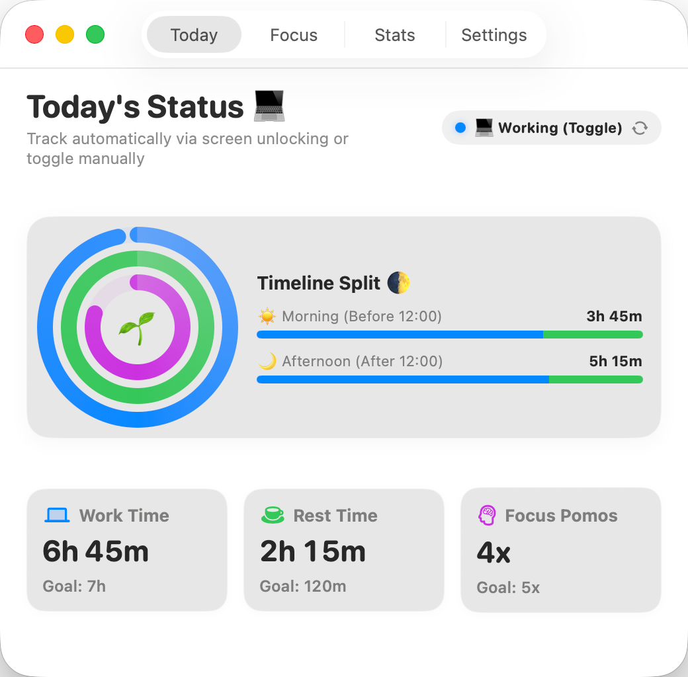
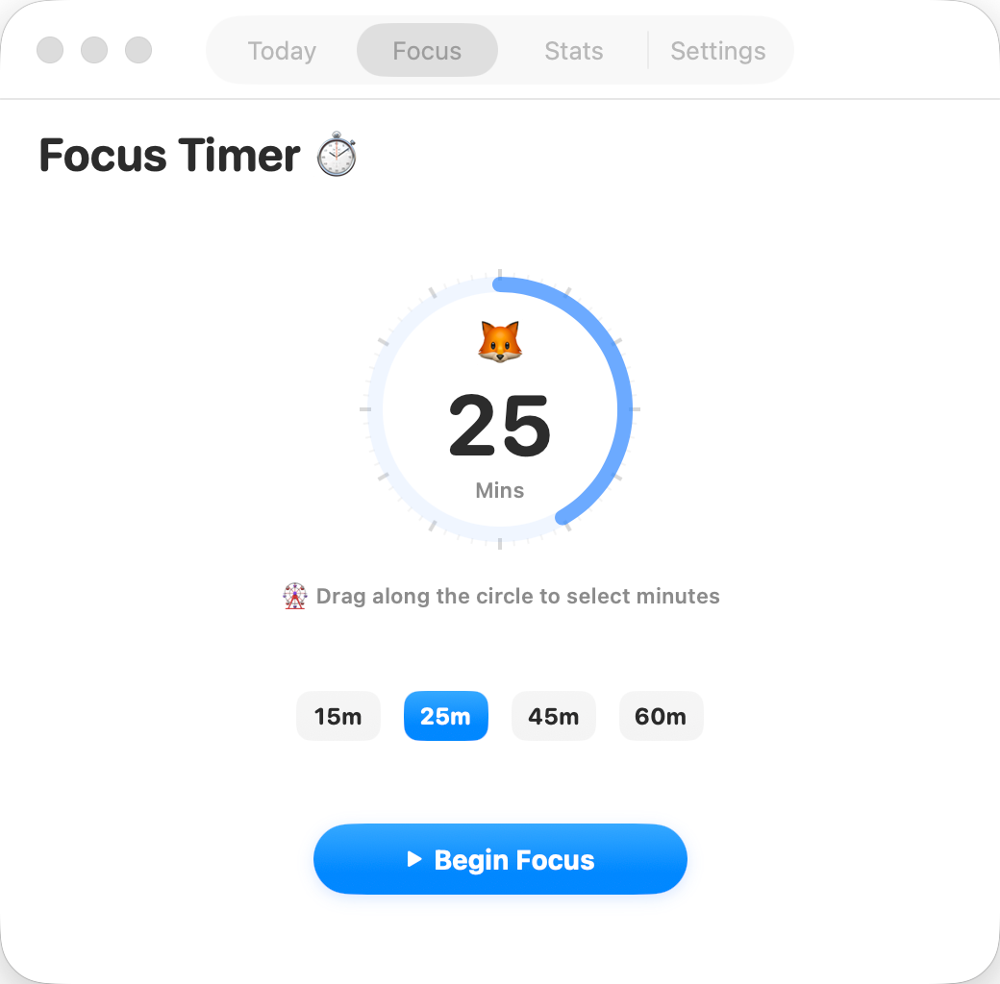
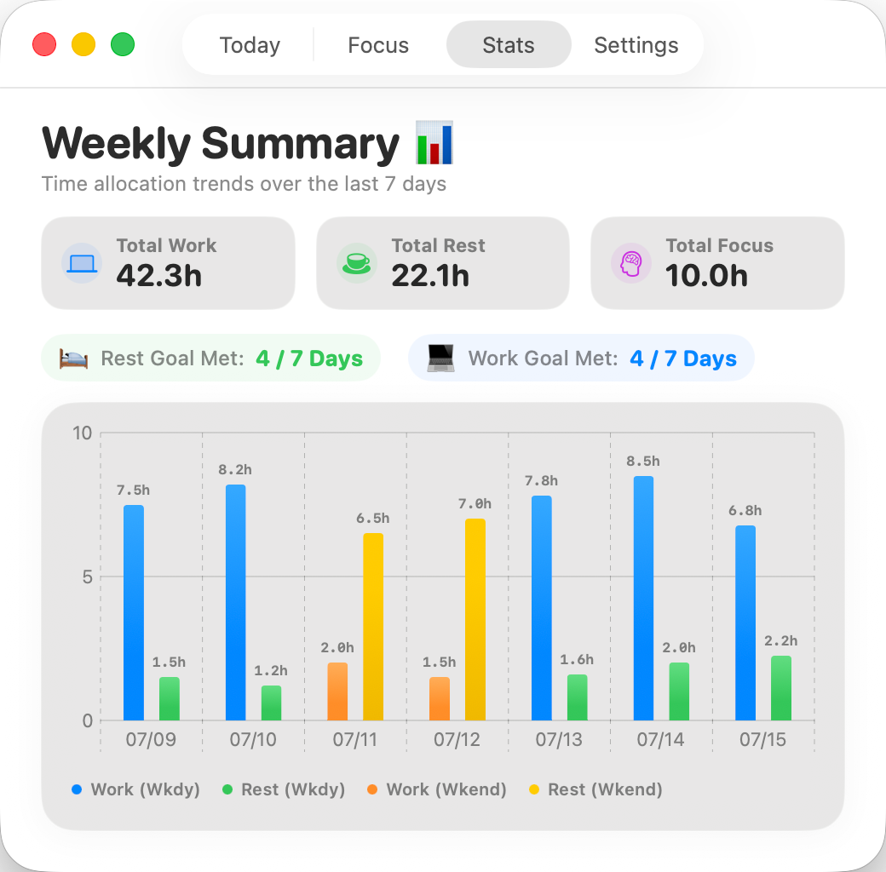

# 🧸 TimeTracker V3

A modern, cute, and professional time-tracking and focus companion app built natively for macOS using **SwiftUI**. 

`TimeTracker` helps you balance your work hours, track rest times, automatically exempt lunch hours, detect user idleness, and focus using a beautiful Apple Watch-style Pomodoro dial. It also seamlessly synchronizes with the macOS native Focus Mode (Do Not Disturb) via Apple Shortcuts!

---

## 📸 Screenshots

### 💻 Today's Dashboard & ⏱️ Focus Timer
<p align="center">
  
  
</p>

### 📊 Weekly Analytics
<p align="center">
  
</p>

---

## 🌟 Key Features

*   **Today's Overview (Today's Status 💻)**: Display your active work, rest, and focus stats in a watch-style 3-ring progress visual and track morning vs. afternoon splits (`Timeline Split 🌓`).
*   **Rotary Focus Timer (Focus Timer ⏱️)**: A high-end watch-chronometer tactile rotary timer allowing you to drag your mouse/trackpad around the dial to set your focus duration.
*   **Weekly Statistics (Weekly Summary 📊)**: Beautiful Swift Charts displaying weekday vs. weekend time allocation with hoverable precise hour labels and weekend lemon/orange color accents.
*   **Smart Auto-Exemption (Lunch Break ☕️)**: Restrict and auto-exempt lunch time blocks from being counted as active work or rest.
*   **Idle Auto-Detection (Idle Auto-Detection 💤)**: Stop tracking active work and switch to rest state automatically if mouse or keyboard activity ceases for *N* minutes.
*   **macOS Focus Sync (Sync Focus ⚙️)**: Automatically toggle native macOS Do Not Disturb on/off when you start/stop focus sessions.
*   **Zero-Configuration Launch (Launch at Login 🚀)**: Toggles native login item launch dynamically via macOS ServiceManagement APIs.

---

## ⚙️ How to Configure macOS Focus Sync (Focus Sync Guide)

Due to macOS sandbox security restrictions, native applications cannot directly toggle system-level Do Not Disturb. `TimeTracker` handles this elegantly using the official macOS **Shortcuts** engine:

1. Open the **Shortcuts** App on your Mac and click **`+`** (create a new shortcut).
2. Create **Shortcut 1**:
   *   Name it exactly: **`FocusOn`**
   *   Add action: **`Set Focus`** ➡️ Set to **`Turn Do Not Disturb On`**.
3. Create **Shortcut 2**:
   *   Name it exactly: **`FocusOff`**
   *   Add action: **`Set Focus`** ➡️ Set to **`Turn Do Not Disturb Off`**.
4. Enable the **Sync macOS Focus (DND)** switch inside `TimeTracker` Settings. The app will handle the rest!

---

## 🛠️ Build and Compiling

This project is built using a modern **XcodeGen** project configuration scheme.

### Prerequisites

*   Xcode 14.0 or later (macOS 13.0+)
*   `xcodegen` CLI command-line compiler (optional, can run `build.sh`)

### Fast Compiling

Run the built-in compiler script inside your terminal:
```bash
./build.sh
```
This cleans builds, compiles all resources, sign-packages the application, and exports a standalone `/TimeTracker.app` bundle ready to run.

---

## 📂 Code Structure & Best Practices

The codebase is organized cleanly following native SwiftUI MVVM (Model-View-ViewModel) design paradigms:

*   **`Sources/App`**: Application initialization, window management, and background menu bar hooks.
*   **`Sources/Models`**: Codable database structures (`DailyRecord`) and data persistence routines.
*   **`Sources/ViewModels`**: The central state manager (`TimeManager.swift`) executing timers, shortcuts triggering, notifications scheduling, and UserDefaults caching.
*   **`Sources/Views`**: Modular view layout files:
    *   `ReviewView.swift`: Displays the 3 progress rings, AM/PM progress bars, and detail cards.
    *   `FocusView.swift`: Controls the watch-style circular slider gestures and countdowns.
    *   `ChartsView.swift`: Renders Swift Charts graphs with weekend highlighting.
    *   `SettingsView.swift`: Renders grouped lists, custom sliders, clipboard copy buttons, and lunch grids.
    *   `VisualEffectBlur.swift`: Standard modular NSViewRepresentable blur backdrop.
*   **`Sources/Assets.xcassets`**: Apple-compliant resolution icons, colors, and localizable strings.

---

## 📄 License

This project is open-sourced under the **MIT License**. Feel free to fork, customize, and submit PRs to build your ultimate time-tracking assistant!
