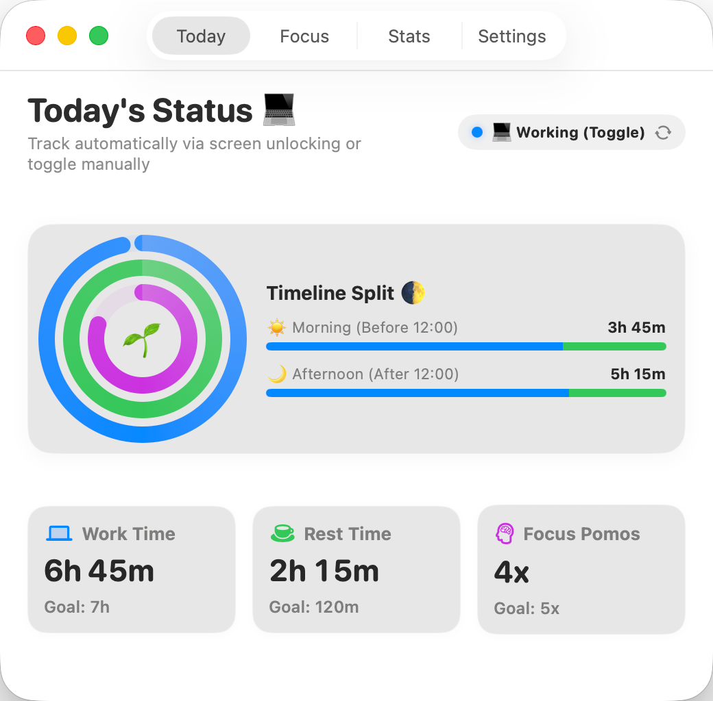
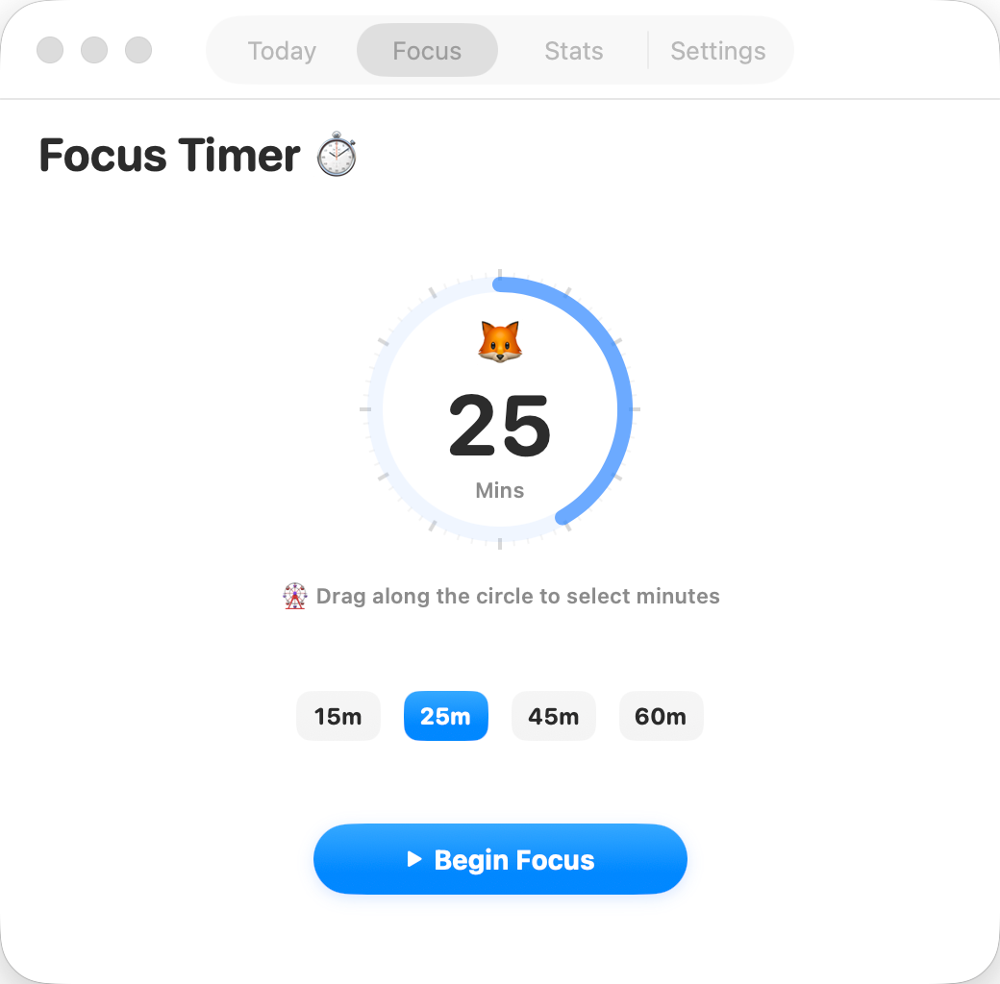
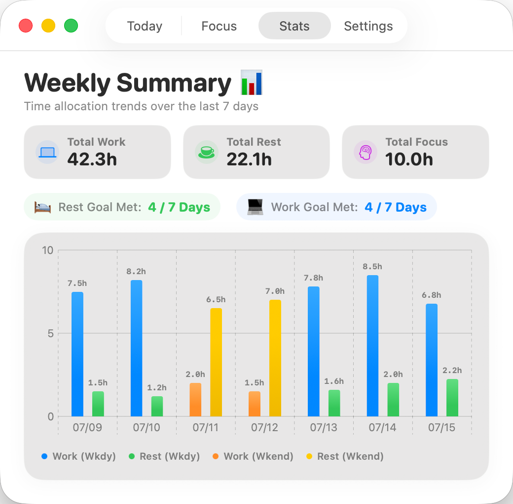

# 🧸 TimeTracker V3

一款专为 macOS 打造的原生、可爱且专业的个人时间追踪与专注力提升工具，使用 **SwiftUI** 原生构建。

`TimeTracker` 致力于帮您平衡工作时间、记录休息时间、自动扣除午休时段、智能检测闲置状态，并提供极具 Apple Watch 质感的番茄钟拖拽拨盘。它还可以通过系统自带的快捷指令（Shortcuts）自动与 macOS 原生的勿扰模式进行完美联动！

---

## 📸 界面预览

### 💻 今日状态 & ⏱️ 番茄专注
<p align="center">
  
  
</p>

### 📊 周度分析
<p align="center">
  
</p>

---

## 🌟 核心功能亮点

* **分级休息提醒**：连续工作 30 分钟时发送静默系统通知；60 分钟时升级为居中的橙色休息卡片，配一次轻提示音。可选择「开始休息」或「10 分钟后提醒」。继续工作时每 15 分钟提醒一次；锁屏、休息和午休会重置提醒。设置中可随时预览卡片。
* **本次工作进度**：今日页面显示连续时长、下次提醒倒计时，以及工作、休息、专注目标进度。

*   **今日状态 (Today's Status 💻)**：提供酷似 Apple Watch 的三环（工作、休息、专注）进度展示，并精细分析上午与下午的活跃时段占比（`时段占比 🌓`）。
*   **旋钮番茄钟 (Rotary Timer ⏱️)**：高拟真触觉旋转拨盘。您可以直接用鼠标或触控板按住圆环边缘进行拖拽旋转，直接锁定 `5 ~ 60分钟` 的专注时长。
*   **周度报表统计 (Weekly Analytics 📊)**：基于 Swift Charts 的条形图，自动区分工作日（蓝/绿）与周末（橙/黄），支持顶部具体时长悬浮标示，达成情况一目了然。
*   **午休免记录 (Smart Exemption ☕️)**：可自由指定特定中午时间段（例如 12:00 - 14:00），系统在此时间段内将自动暂停全部追踪（免记录），避免餐点和午睡干扰日常数据真实性。
*   **自动闲置判定 (Idle Auto-Detection 💤)**：当键盘与鼠标完全静止超过设定分钟（例如 5 分钟）时，系统会自动将该状态判定为“休息”，杜绝忘退状态导致的数据积压。
*   **系统勿扰模式联动 (macOS Focus Sync ⚙️)**：支持开启/结束专注时自动同步设定系统原生的“勿扰模式”。
*   **开机自启动支持 (Launch at Login 🚀)**：集成最新的 `SMAppService` API，后台静默管理启动项，无需用户繁琐配置。

---

## ⚙️ 系统勿扰模式联动配置指引 (10秒快速配置)

出于 macOS 沙盒安全限制，第三方应用无法直接修改系统的全局专注模式。`TimeTracker` 采用官方推荐的 **快捷指令 (Shortcuts)** 实现安全联动：

1. 打开 Mac 自带的 **「快捷指令」** App，点击顶部菜单栏的 **`+`** 加号以新建指令。
2. 创建**指令一**：
   *   命名为：**`FocusOn`**
   *   拖拽右侧动作：**「设定专注模式」** (英文系统搜索 `Set Focus`) ➡️ 设为 **「开启 勿扰模式」**。
3. 创建**指令二**：
   *   命名为：**`FocusOff`**
   *   拖拽右侧动作：**「设定专注模式」** (英文系统搜索 `Set Focus`) ➡️ 设为 **「关闭 勿扰模式」**。
4. 打开 `TimeTracker` 控制中心设置，勾选 **「联动系统专注模式」**。大功告成！App 会在开始/结束专注时全自动托管您的勿扰状态。

---

## 🛠️ 项目构建与编译

本项目使用现代的 **XcodeGen** 进行工程架构配置。

### 准备工作

*   Xcode 14.0 或更高版本 (支持 macOS 13.0+)
*   `xcodegen` 命令行工具（可选，您也可以直接运行构建脚本）

### 极速构建

在终端中执行内置脚本以完成一键编译与签名打包：
```bash
./build.sh
```
成功后将在项目根目录下输出可直接运行的独立的 `/TimeTracker.app` 应用程序。

---

## 📂 代码架构与开源规范

代码目录遵循标准的 SwiftUI MVVM 软件开发模式，解耦度高且命名规范，非常利于二次开发与二次修改：

*   **`Sources/App`**：App 启动生命周期、窗口管理器以及后台菜单栏逻辑。
*   **`Sources/Models`**：本地数据存储模型定义与 CSV 导出模块。
*   **`Sources/ViewModels`**：核心状态管理器 `TimeManager.swift`（执行定时器轮询、快捷指令分发、通知派发、UserDefaults 偏好持久化）。
*   **`Sources/Views`**：高度解耦的视图文件：
    *   `ReviewView.swift`：今日状态三环、活跃占比条及底部数据块。
    *   `FocusView.swift`：转盘拖拽交互手势及倒计时组件。
    *   `ChartsView.swift`：Swift Charts 统计柱状图及周末高亮组件。
    *   `SettingsView.swift`：滑动条设置、午休网格点选、一键复制板及系统集成项。
    *   `VisualEffectBlur.swift`：原生 NSVisualEffectView 模糊背景层包装。
*   **`Sources/Assets.xcassets`**：App 图像资源集、颜色定义与中英文本地化字符串文件。

---

## 📄 开源许可证

本项目基于 **MIT License** 开源。欢迎 fork、提交 PR、或者在 Issue 中提出您更具创意的功能！

## 提醒与界面验证

```bash
bash Tests/run_checks.sh
```

检查涵盖 30/60 分钟阈值、15 分钟重复、10 分钟稍后提醒、锁屏与休息重置，以及实际通知文案。界面的中英文、明暗模式和紧凑布局预览生成在 `build/previews/`，测试不会启动后台服务或读取真实记录。

如需匹配原先安装版的 Finder 自定义图标，可在本地构建时使用：

```bash
MATCH_REFERENCE_FINDER_ICON=1 ./build.sh
```

此选项在正常签名并校验后添加 Finder 自定义图标元数据，严格签名校验会拒绝这些元数据；发布构建应省略该选项。图标来源及构建说明见 `Resources/AppIconReference.md`。

## 系统通知图标验证

手动构建会同时打包经过源码校验的 Xcode 原生图标目录和 ICNS 后备图标。
日常编译可直接使用已提交的资源；更新图标时需要完整 Xcode：

```sh
bash Resources/compile_app_icon.sh Resources/CompiledIcons
./build.sh
python3 Tests/check_bundle.py TimeTracker.app
```

设置中的「测试系统通知」会真正发送一条静默通知，副标题标明版本和构建号。
也可以通过 `--notification-icon-test` 启动参数触发。请用这条系统通知验证图标，
Finder 图标和应用内的醒目提醒卡片预览不能代替这一检查。

1.1 (5) 起使用稳定的新应用标识 `com.antigravity.TimeTracker.macOS`，避开本机旧通知身份的占位图标问题。
首次启动会一次性导入旧标识下的偏好，保留已有新设置；计时历史继续使用原数据目录。
系统通知需要重新允许。升级旧版本前应先关闭旧应用的「开机启动」，新版本会依据迁移的设置恢复启动项。
